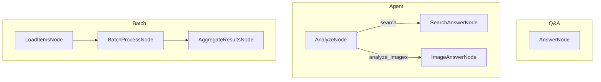

# ai_wraper

A small terminal AI assistant built in Go on top of [Flyt](https://github.com/mark3labs/flyt), a graph-based workflow framework. It wraps the Google Gemini API behind a keyboard-driven CLI so you can ask questions, get search-grounded answers, and analyze images/screenshots without opening a browser.

Originally built for a Fedora + Hyprland setup, driven by a Rofi launcher (`ask-ai`).

## Features

- **Multiple workflow modes** — simple Q&A, an agent flow that routes to web search or image analysis, and a batch demo flow.
- **Gemini integration** — text, Google Search grounding, and multimodal (image) requests via the Generative Language API.
- **Markdown answers** — rendered with [`bat`](https://github.com/sharkdp/bat) for a clean terminal output.
- **Persistent system prompt** — loaded from `config/system_instructions.md` (overridable).
- **Conversation history** — kept in memory during a session and saved to JSON on `Ctrl+C`.
- **Rofi/Hyprland launcher** — `ask-ai` script for quick questions, clipboard images, and screenshots.
- **Dependency-light** — only `flyt` and `godotenv` as direct dependencies.

## Architecture

The app is organized as a Flyt flow made of reusable nodes. Each node has three phases:

1. **Prep** — read state from the shared store and prepare inputs.
2. **Exec** — do the work (e.g. call the LLM).
3. **Post** — write results back to the shared store and return the next action.

### Flows

| Mode | Flow | Description |
|------|------|-------------|
| `qa` | `AnswerNode` | Single LLM call with conversation history. |
| `agent` | `AnalyzeNode` → `SearchAnswerNode` / `ImageAnswerNode` | Routes to image analysis if `-images` is given, otherwise search-grounded answering. |
| `batch` | `LoadItemsNode` → `BatchProcessNode` → `AggregateResultsNode` | Demo of concurrent item processing. |



## Project structure

```
ai_wraper/
├── main.go                     # Entry point: flags, input loop, answer rendering, history saving
├── flow.go                     # Flow definitions (qa, agent, batch)
├── nodes.go                    # Node implementations
├── ask-ai                      # Rofi/Hyprland launcher script (bash)
├── go.mod / go.sum
├── .env.example                # Example environment configuration
├── config/
│   └── system_instructions.md  # Default system prompt
├── docs/
│   └── design.md               # Architecture and design notes
└── utils/
    ├── llm.go                  # Gemini API helpers (text, search, images, streaming)
    ├── search.go               # Search helpers (SerpApi / DuckDuckGo / mock)
    ├── text.go                 # Text processing utilities
    └── utils.go                # Conversation history types and helpers
```

## Requirements

- Go **1.24** or later
- A **Gemini API key** (`GEMINI_API_KEY`)
- [`bat`](https://github.com/sharkdp/bat) for rendering markdown answers
  - Fedora: `sudo dnf install bat`
  - Debian/Ubuntu: `sudo apt install bat`
- Optional: **Rofi**, **kitty**, **grim**, **slurp**, **wl-paste** for the `ask-ai` launcher (Wayland)

## Setup

Clone the repository and install dependencies:

```bash
git clone <repo-url>
cd ai_wraper
go mod tidy
```

Create your `.env` file from the example (the app loads `.env` at startup and exits if it is missing):

```bash
cp .env.example .env
```

Edit `.env`:

```dotenv
GEMINI_API_KEY="your-api-key-here"
SERPAPI_API_KEY=""               # optional, not currently used
SYSTEM_INSTRUCTIONS_PATH=""      # optional, defaults to config/system_instructions.md
```

## Usage

Run directly:

```bash
go run .
```

Or build a binary:

```bash
go build -o build_files/ai-query
./build_files/ai-query
```

When prompted, enter your text and finish with a line containing `EOF` (or `Ctrl+D`). Type `quit` or `exit` to leave.

### Flags

| Flag | Default | Description |
|------|---------|-------------|
| `-mode` | `qa` | Flow to run: `qa`, `agent`, or `batch`. |
| `-model` | `gemini-2.5-flash` | Gemini model to use (e.g. `gemini-2.5-pro`). |
| `-images` | `""` | Comma-separated list of image paths (used by `agent` mode). |
| `-v` | `false` | Verbose output. |

Example:

```bash
go run . -mode=agent -model=gemini-2.5-pro -images=screenshot.png
```

### Conversation history

- History is kept in memory across prompts during a session.
- Press `Ctrl+C` to save the conversation to `Conversations/<name>_<timestamp>.json` before exiting.
- The conversation name is derived from the first prompt.

## Configuration

| Variable | Required | Description |
|----------|----------|-------------|
| `GEMINI_API_KEY` | Yes | API key for the Google Generative Language API. |
| `SYSTEM_INSTRUCTIONS_PATH` | No | Path to a markdown system prompt. Defaults to `config/system_instructions.md`. |
| `SERPAPI_API_KEY` | No | Reserved for a future SerpApi-backed search node; not used by the active flows. |

- The default model is `gemini-2.5-flash` and can be overridden with the `-model` flag.
- System instructions are sent as the `systemInstruction` field on each request. If the file can't be read, the app logs a warning and continues without it.

### LLM helpers (`utils/llm.go`)

- `CallLLM(prompt)` — text-only request.
- `CallLLMWithSearch(prompt)` — enables Google Search grounding; appends a **Sources** section when grounding metadata is returned.
- `CallLLMWithImages(prompt, imagePaths)` — attaches base64-encoded images (`.jpg`, `.jpeg`, `.png`, `.webp`, `.heic`, `.heif`).
- `CallLLMWithConfig(prompt, config, useSearch)` — low-level call with custom temperature/token settings.
- `CallLLMStreaming(onChunk)` — placeholder that currently wraps the non-streaming call.

## Rofi / Hyprland launcher

The `ask-ai` script provides a keyboard-driven menu for quick questions, deeper analysis, clipboard images, and screenshots.

1. Edit `ask-ai` and set:
   - `PROJECT_DIR` — absolute path to this project.
   - `AI_BINARY` — path/name of the compiled binary (e.g. `build_files/ai-query`).
2. Install it:

```bash
cp ask-ai ~/bin/ask-ai
chmod +x ~/bin/ask-ai
```

3. Bind a key in your Hyprland config to run `~/bin/ask-ai`.

Notes:

- Screenshots use `grim`/`slurp`; clipboard images use `wl-paste` (Wayland).
- The script launches the binary inside `kitty` and cleans up temporary files automatically.

## Design notes

See [`docs/design.md`](docs/design.md) for the design rationale, shared-store layout, node responsibilities, and extension points. In short:

- Add new nodes in `nodes.go` and wire them in `flow.go`.
- Keep each node single-purpose: read in **prep**, work in **exec**, write in **post**.
- Extend `utils/llm.go` to support additional providers or request features.

## Limitations

- `batch` mode is a demonstration and prints aggregated results directly; it does not set the `answer` key consumed by the interactive loop.
- `CallLLMStreaming` is not truly streaming yet.
- `SERPAPI_API_KEY` and the SerpApi search node are not wired into the active flows.
- There are no automated tests yet.

## License

MIT.
